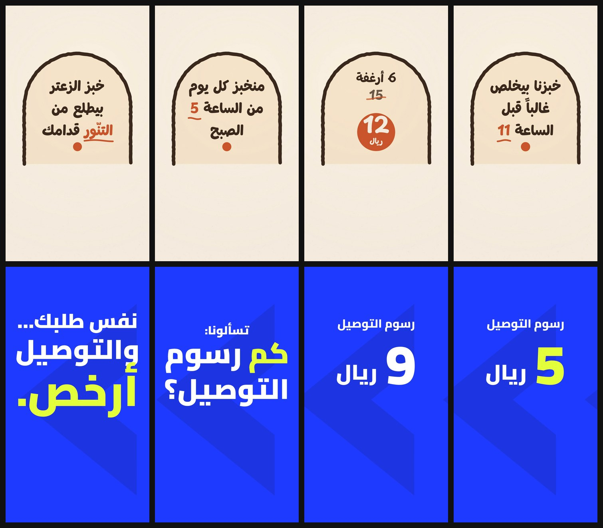
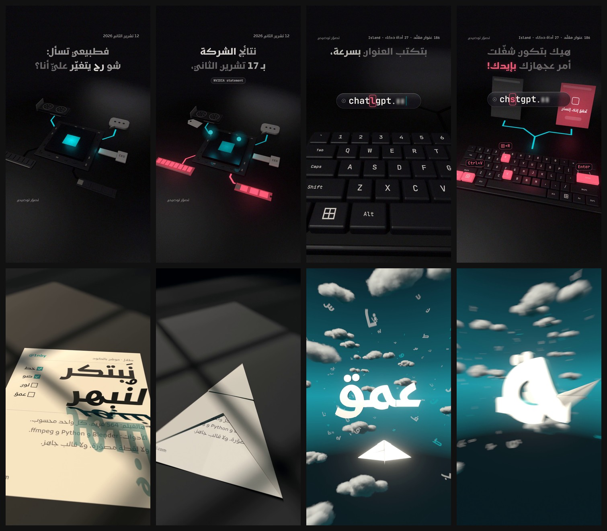
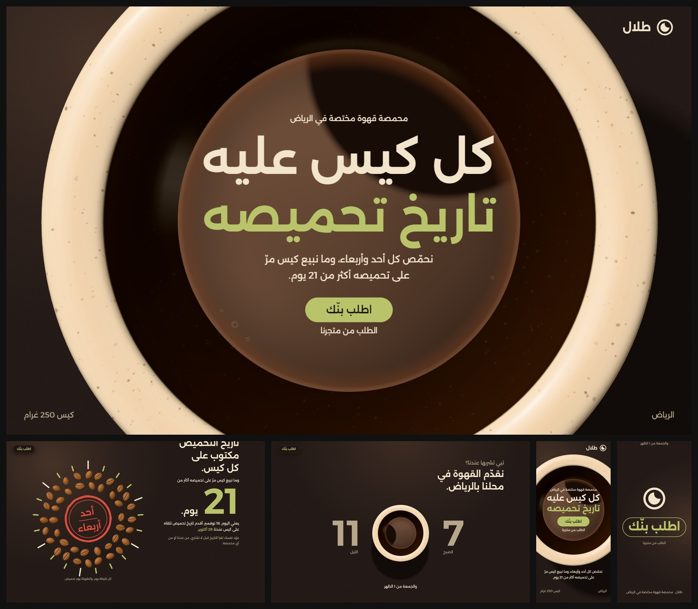
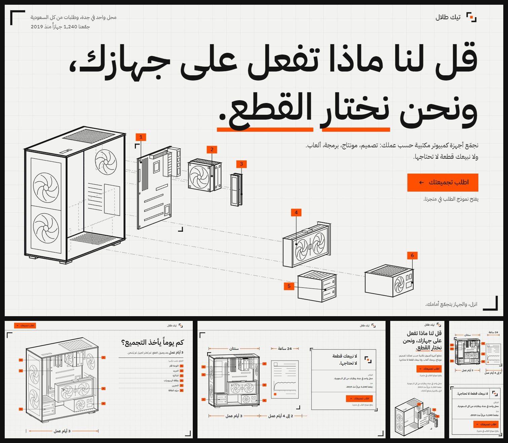

<p align="center"></p>

# Tiraz · طِراز

مخرج فني يعمل داخل Claude Code: يصمّم لهويتك شكلاً خاصاً بها من الصفر، ثم يصنع به مقاطع الريلز وموقعك، على جهازك أنت.

**طريقتان للشكل.** إمّا شكل يُصمَّم لك من الصفر، وإمّا أسلوب تختاره من 114 أسلوبًا جاهزة. والأسلوب الجاهز ليس قالباً يوضع عليه شعارك: يُرسم كله بألوانك وخطّك وشعارك، ولا يحمل لوناً ولا اسماً من عنده، وتُنسخ منه نسخة إلى مجلدك تصير لك وحدك. وما يحتويه طِراز فوق ذلك هو الطريقة: كيف تُفهم الهوية، وكيف يولد لها شكل، وكيف تُكتب الجملة الافتتاحية، وكيف يتحرّك النص العربي، وكيف يُفحص كل شيء قبل أن تراه.

الطِّراز في العربية هو الأسلوب والنمط. وكان قديماً شريطَ الكتابة المنسوج في القماش، يذكر أين صُنع ولمن.

**أنشأه طلال** · [xtalal.com](https://xtalal.com)

A director for Claude Code: it designs a look for your brand from scratch, or draws one of 114 ready styles (five of them in 3D) entirely in your colours, font and logo, and makes your reels and your site in it, on your own machine. [English summary](#english) at the end.

[نماذج](#نماذج) · [التثبيت](#التثبيت) · [بالتفصيل](#بالتفصيل) · [ماذا يحتوي](#ماذا-يحتوي) · [حدود هذه النسخة](#حدود-هذه-النسخة-10)

## لماذا طِراز

- **شكل يُصمَّم لك، لا قالب يُعبَّأ.** ترى ثلاثة اتجاهات في صور حقيقية قبل أن يُبنى شيء، أو ثلاثة أساليب من المكتبة مرسومة على هويتك أنت، وما تختاره يُكتب شيفرةً في مجلدك ويبقى لك.
- **العربية أولاً.** حروف لا تتفكّك، وكلمة لا تنكسر على سطرين، ورقم يقف حيث كتبته، واتجاه من اليمين في كل شيء.
- **لا رقم بلا مصدر.** كل سعر وعدد ومدة يُقارَن بجدول حقائقك، وما ليس فيه يُرفض قبل أن يخرج العمل.
- **يُفحص قبل أن تراه.** الريل يُقاس ملفاً وصوتاً ونصاً. والصفحة تُفتح في المتصفح وتُمرَّر كما يمرّرها زائرها، ثم يقرؤها قارئ لا يعرف ما قُصد بها.
- **كل شيء على جهازك.** لا خادم ولا حساب ولا نشر: يسلّمك ملفاتك، والقرار لك.

## كيف يعمل

<div dir="rtl">

| | الخطوة | ما ينتج عنها |
|---|---|---|
| 1 | **التهيئة** | مقابلة قصيرة، يليها مجلد هويتك: الألوان والخط والشعار واللهجة والجمهور وجدول الحقائق المسموح ذكرها |
| 2 | **الشكل** | يدرس Claude شعارك ومنتجك وذوقك، ثم يعرض عليك **ثلاثة اتجاهات في صور حقيقية** تحمل الكلام نفسه. تختار واحداً، فيُبنى شيفرةً في مجلدك: خلفيتك وحركتك وخاتمتك. أو، أسرع، تختار أسلوباً من مكتبة الأساليب العشرة مرسوماً بألوانك |
| 3 | **الريل** | جملة افتتاحية، وسطور، ومشاهد بشكلك أنت، وصوت، وفحص. ما ينقص من المشاهد يُكتب لك ويبقى عندك للريل التالي |
| 4 | **الموقع** | صفحة عربية بالشكل نفسه، ملفاتٍ عادية تستضيفها حيث تشاء |

</div>

يُصمَّم الشكل مرة واحدة ويبقى لك. وكل ريل بعده يشبه ما سبقه، ولا يشبه أحداً سواك.

## نماذج

### ريلات: هويتان من الصفر



هاتان هويتان وهميتان جُرّب عليهما طِراز من الصفر: مخبز حيّ (في الأعلى) وتطبيق توصيل (في الأسفل). أُعطي Claude لكل منهما ورقة بأجوبة صاحبها وشعاراً بسيطاً لا غير، ثم سار على المهارات وحده: اقترح ثلاثة اتجاهات، واختار واحداً، وبناه، وأخرج ريلاً اجتاز الفحص. الصور مأخوذة من الريلين كما خرجا، بلا أي تعديل يدوي. صُنع المخبز بنموذج Sonnet والتطبيق بنموذج Opus.

الشكلان لا يتشابهان، لأن لا قالب ينطلقان منه: شكل المخبز خرج من قوس الفرن في شعاره، وشكل التطبيق خرج من سهم شعاره.

### ثلاثي الأبعاد في الريلات: من أعمال طلال



لقطات من ثلاثة ريلات منشورة على حساب طلال <span dir="ltr">@1nby</span>. مشاهدها الثلاثية الأبعاد صُنعت في Blender وصُيّرت إطاراً إطاراً. طِراز يُدخل طبقة كهذه في الريل ([دليل المشاهد](guides/scenes.md)، القسم 6)، لكنه لا يحتوي مشاهد جاهزة ولا ملفات Blender. هذا شكل طلال الخاص وليس جزءاً من طِراز، والصور هنا لتُري ما يبلغه ريل كُتب لهويته مشهد من هذا النوع.

### مواقع: صفحتان من الصفر





صفحتان لهويتين وهميتين، بُنيتا في جلسات Claude جديدة لا تعرف عن طِراز إلا ما في ملفاته، بلا قالب ولا مثال. فكرة كل صفحة خرجت من هويتها:

- **المحمصة:** الصفحة كلها نظرة واحدة من فوق، كما يرى شعارها الفنجان. التمرير يحمّص الحبّات ويختمها بيومَي التحميص ويعدّ 21 يوماً، ثم يطحنها، وفي الختام يصغر الفنجان حتى يصير هو الشعار.
- **محل التجميع:** الصفحة رسمة هندسية واحدة. الجهاز يتجمّع قطعةً قطعة مع التمرير، وكل سؤال من أسئلة الزبون جوابه ملاحظة على الرسمة، وخطوط القياس تقيس مدة التجميع والضمان بدل الطول.

وهذا ما جرى بصراحة:

- المحاولة الأولى لكل صفحة (على Opus) خرجت صحيحة وعادية: اجتازت كل فحص، وليس فيها ما يُتذكَّر. بعدها كُتب قسم «صفحة يتذكّرها الناس» في دليل الموقع، وأُعيد البناء على Fable 5.2.
- كل صفحة أخذت بعد ذلك جولتَي عمل، بينهما ملاحظات. الجولة الواحدة أخذت من عمل النموذج بين نصف ساعة وأربع ساعات.
- بعد كل جولة قرأها قارئ أعمى جديد لم يرَ إلا الصور والقياسات، وأعطاها درجة على معايير Awwwards المنشورة (التصميم 40%، وسهولة الاستخدام 30%، والإبداع 20%، والمحتوى 10%)، بسلّم صارم يبدأ كل بند فيه من 6: المحمصة 7.15 ثم 7.35، ومحل التجميع 7.0 ثم 7.6. ثم بُدّل خط المحمصة بطلب صاحبها، فقرأها قارئ ثالث وأعطاها 7.15: القرّاء يختلفون بعُشرَين أو نحوهما، فالدرجة تقريب لا ميزان. وفي كل مرة قال القارئ فكرة الصفحة في جملة، فطابقت المكتوب في خطتها.
- هذه درجات قارئ آليّ، لا حكم لجنة. طِراز لا علاقة له بـ Awwwards، ولم تُعرض الصفحتان عليها.
- وما زال في كل صفحة ما سمّاه القارئ ولم يُصلح: في المحمصة صفوف القائمة لا تجيب المؤشر وشريط الطلب على الهاتف غير مصمَّم، وفي محل التجميع بطاقة الأسعار تنزل فوق الرسمة. والصور أعلاه من الحالة التي نالت آخر درجة لكل صفحة.

مصدر الصفحتين ليس في طِراز، فهو يعطيك الطريقة لا التصميم.

## التثبيت

تحتاج إلى: [Claude Code](https://claude.com/claude-code)، و Node 18 أو أحدث، و Python 3.10 أو أحدث مع `numpy` و`soundfile` و`pillow`، و `ffmpeg`، ومتصفح Chrome. وللتعليق الصوتي: مفتاح ElevenLabs خاص بك (اختياري). ولكتابة خط الصفحة بصيغة <span dir="ltr">WOFF2</span>: `fonttools` و`brotli` (اختياري، والصفحة تعمل بدونهما بالخط كما هو).

```bash
git clone https://github.com/6iiz/tiraz.git
cd tiraz
npm install
claude --plugin-dir .
```

أو من داخل Claude Code:

```
/plugin marketplace add 6iiz/tiraz
/plugin install tiraz@tiraz
```

ثم اكتب لـ Claude: **«ابدأ»**. يفحص جهازك، ويجري معك المقابلة، ويصمّم لك شكلك. وبعد ذلك: **«اصنع ريلاً»** أو **«اصنع موقعاً»**.

## بالتفصيل

### العربية أولاً

- يُشكَّل النص بمحرّك HarfBuzz ويُرسم من حدود الحروف نفسها، فالوصل والتشكيل والحروف المركّبة صحيحة في كل إطار، مهما كان التأثير.
- النص الذي يضيق به مكانه يصغر على درجات، ثم ينتقل إلى سطر جديد **عند حدود الكلمات فقط**: الكلمة العربية لا تُقسم أبداً. وإن بقي أعرض من مكانه توقّف التصيير برسالة تسمّيه، ولم يخرج مقطوعاً.
- تُرسم الكلمات من جهة القراءة كلمةً كلمة، فتبقى الأرقام والكلمات اللاتينية في مواضعها داخل الجملة العربية.
- الكلمة التي تظهر أو تختفي تدريجاً تُرسم قطعةً واحدة، فلا يظهر خط أغمق عند كل وصلة بين حرفين.
- يظهر النص العربي كلمةً كلمة في الأصل، وحروفه لا تُباعَد أبداً مهما كان التأثير.
- الرقم الذي يعدّ يُرسم في خانات متساوية فلا يهتزّ، ويقف على الرقم المكتوب بالضبط، بفواصله وبنظام أرقامه.
- في الصفحات: اتجاه الصفحة ولغتها معلنان، ورقم الهاتف والكلمات اللاتينية جزر من اليسار إلى اليمين داخل السطر العربي، ونظام أرقام واحد في الصفحة كلها، والعملة بعد المبلغ.

### الشكل يُصمَّم، أو يُختار ويُرسم لك

- يبدأ من موادّك أنت: الشعار، والمنتج، وأجوبتك في المقابلة، وما تحبّه وما تنفر منه من أعمال غيرك مع السبب.
- الاتجاهات الثلاثة تختلف في **الفكرة** لا في اللون، وتُعرض إطاراتٍ حقيقية تحمل الكلام نفسه لتقارن بينها بعينك.
- اختباران قبل أن يُعرض عليك شيء: لو غُطّي الشعار، أما زال العمل لك؟ ولو وُضع مكانه شعار منافسك، أما زال يصلح؟ (يجب ألّا يصلح.)
- ما تختاره يُبنى شيفرةً في `tiraz/brand/look/`: الأرضية، وطريقة الحركة، والخاتمة، وأرقام الشكل (المقاسات والمدد ومنحنيات الحركة)، ووصفه بالكلمات مع ما يُفعل دائماً وما لا يُفعل أبداً.
- كل ملاحظة تقولها تُكتب بتاريخها وبكلماتك في `rules.md`، وتغلب أي قاعدة في طِراز.
- **أو من المكتبة، وهو أسرع:** في `styles/` 114 أسلوبًا، منها خمسة ثلاثية الأبعاد (حروف معدن، زجاج وضو، صلصال، مدينة الحروف، الشبكة المجسّمة)، ومن الطباعة والورق (سويسري، ريزو، حفر على الخشب، أوكيو-إي) إلى الشاشات (طرفية قديمة، هولوغرام، رادار) والرسم اليدوي (طباشير، ألوان مائية، فلوماستر) والكرتون والبكسل والمجسّمات (`styles/index.json` يعدّها بسطر لكل واحد). يرسم Claude الثلاثة الأنسب لك على هويتك أنت قبل أن تراها، وما تختاره يُنسخ إلى مجلدك ويصير لك، تعدّله كما تشاء. وكل أسلوب يعمل مع أي ترتيب من الترتيبات الخمسة في `arrangements/` (نظام واستثناء، قبل وبعد، خطوات، رقم يثبت، سؤال وجواب).

### الريل

- **كل إطار دالّة في الزمن وحده:** لا ساعة ولا عشوائية بلا بذرة ولا حالة من الإطار السابق. تصيير اللحظات نفسها مرتين يعطي ملفين متطابقين، وقد قِيس ذلك.
- المقاس <span dir="ltr">1080×1920</span>، بستين إطاراً في الثانية.
- 279 انتقالاً جاهزاً، لكن الأصل بين مشهدين هو **القطع**. أي وصل آخر قرار من شكل هويتك، أو انتقال يُكتب لها وحدها.
- الترجمة المصاحبة موقّتة على الكلمة المنطوقة، وشكلها من شكل هويتك.
- يطلب المشهد **نوع** الصوت من 22 نوعاً، مثل <span dir="ltr">pop</span> و<span dir="ltr">whoosh</span> و<span dir="ltr">riser</span>، لا اسم ملف. أصواتك أنت تُستعمل أولاً. الصوت الصاعد ينتهي عند لحظته لا يبدأ عندها، والخلفية تنخفض 12 ديسيبل ما دام التعليق يتكلم، والمزج النهائي عند <span dir="ltr">-14 LUFS</span> تقريباً بقمم دون <span dir="ltr">-1 dB</span>.
- المنطقة الآمنة مأخوذة من منشور Meta لمناطق Reels: يُترك لواجهة التطبيق 14% من الأعلى، و35% من الأسفل، و6% من كل جانب، وكل نص يُقاس على ما بقي.

### الصفحة

- **مهمة واحدة** للصفحة، يُتّفق عليها أولاً مع عنوانها ونص زرّها حرفاً حرفاً.
- **تُخطَّط لحظاتٍ لا أقساماً:** افتتاح، ثم ثلاث إلى خمس لحظات، ثم ختام. لكل لحظة ما يراه الزائر يحدث، وأيّ شيء من أشياء الهوية يفعله، وما تفعله يد الزائر، والحقيقة التي تحملها. اللحظة التي تصلح لمنافسك كما تصلح لك زينة تُحذف.
- **الشاشة الأولى تُعرض عليك صورةً** قبل بناء الباقي، وتُحاكَم وحدها كأنها ملصق.
- ملفات عادية: HTML و CSS وقليل من JavaScript. لا إطار عمل ولا خطوة بناء. الخطوط والصور من مجلد الصفحة نفسه، ولا يُطلب شيء من خادم آخر.
- خط الصفحة يُكتب لها من جديد بصيغة <span dir="ltr">WOFF2</span> دون حذف حرف واحد ولا قاعدة وصل: في خطوط طِراز نفسها (49 ملفاً) خرج أصغر بما بين 51% و82%.
- المشهد المرسوم، ثلاثي الأبعاد بمكتبة three.js أو رسماً على canvas بلا أي مكتبة، يُركَّب بآلية تتكفّل بما يدين به كل مشهد للزائر: صورة بديلة حتى يُرسم أول إطار، وإطار واحد بلا حركة لمن طلب تقليلها، وتوقّف حين يخرج المشهد من الشاشة أو تُخفى الصفحة، وعودة الصورة إن رفض المتصفح. والصورة البديلة تُلتقط من المشهد نفسه.
- ما يتبع التمرير واليد آليات جاهزة بلا شكل: قسم يثبّت شاشته والتمرير يشغّل مشهده، وعالم يتبدّل لونه من قسم إلى قسم، وطبقات عمق، وبطاقات تميل نحو المؤشر، وأرقام تعدّ حتى رقمها الصحيح. المسافات والزوايا والمدد قرار شكل هويتك.
- النص كامل ومقروء بلا JavaScript، ولا شيء يحبس التمرير أو يخطفه.
- الصفحة لا تُرفع إلى أي مكان: التسليم مجلد، والاستضافة قرارك.

### لا رقم بلا مصدر

- جدول الحقائق `facts.md`: سطر لكل ما يجوز قوله، بنصّه أو رقمه، ومصدره، وتاريخه.
- كل ما يقرؤه المشاهد من كلمات وأرقام يُكتب في بيانات المشهد لا في شيفرته، فيجمعه الفاحص من ثلاثة مواضع: نصوص المشاهد، وكلمات التعليق الصوتي، ووصف المنشور.
- رقم ليس في الجدول يُرفض الريل بسببه، ولا يُمرَّر بحجة أنه «معقول».
- في الصفحات: لا سعر ولا عدد ولا تقييم ولا ضمان من خارج الجدول، ولا مراجعات ولا شعارات عملاء لم تعطِها أنت. والزر يقول ما يفعله: إن لم تعطِ رقم هاتف لم يُخترع لك رقم.
- وقد تكون النتيجة «غير جاهز للنشر»، مع تسمية ما ينقص: صورة للمنتج، أو جواب عن سؤال لا يعرفه سواك. الدرجة لا تُرفع مجاملة.

### ما يُفحص قبل أن ترى العمل

<details dir="rtl">
<summary><b>فاحص الريل</b>: الملف، والصوت، والأرقام، والوميض، وموضع كل نص</summary>

- الملف: الترميز H.264، والمقاس <span dir="ltr">1080×1920</span>، وستون إطاراً في الثانية، ومجال اللون bt709.
- الصوت: المستوى قرابة <span dir="ltr">-14 LUFS</span>، والقمم دون <span dir="ltr">-1 dB</span>، ونصيب ما يسمعه مكبّر الهاتف الصغير من الطاقة.
- كل رقم يلقاه المشاهد مقابل جدول الحقائق، وتحذير من أي نص كُتب خارج بيانات المشهد.
- الإطار الأول ليس فارغاً: المشاهد يحكم في أول لحظة.
- الوميض: أكثر من ثلاث ومضات للإطار كله في ثانية واحدة يُرفض.
- موضع كل نص من المنطقة الآمنة في تسع لحظات من الريل، مع تسمية النص الذي خرج عنها.
- ورقة واحدة بتلك اللحظات التسع، لتنظر إليها بعينك.
- ثم مراجعة على سلّم من 28 نقطة: الصدق يجب أن ينال درجته الكاملة، والحدّ الأدنى للعرض 75%.

</details>

<details dir="rtl">
<summary><b>فاحص الصفحات</b>: يفتحها في Chrome ويقيس ما يُقاس، ثم يمشيها كما يمشيها زائرها</summary>

على هاتف (<span dir="ltr">390×844</span>) وعلى حاسوب (<span dir="ltr">1440×900</span>):

- اللغة والاتجاه، وعنوان رئيسي واحد، والتمرير الجانبي مع تسمية ما يسبّبه، الأعرض أولاً.
- كل خط يطلبه نص ظاهر: هل حُمّل من مجلد الصفحة، أم يظهر النص بخط الجهاز؟
- تباين كل نص مع ما خلفه: <span dir="ltr">4.5:1</span> للنص العادي و<span dir="ltr">3:1</span> للكبير، والنسبة لا تُقرَّب إلى الأعلى.
- النص فوق صورة أو مشهد: يمشي الفاحص إليه ويقرأ موضعه حيث يقف فعلاً، ولو كان على شاشة ثابتة، ثم يصوّر ما خلفه ويقيسه مقابل أفتح 1% وأغمق 1% من تلك البكسلات. وإن كان النص تحت شريط أنزله أو رفعه في النافذة حتى يظهر.
- السطر الذي يمرّ تحت شريط ثابت لا يُحاسَب وهو تحته: يسأل الفاحص المتصفح عمّا فوق كل سطر، ويقيس الجزء الظاهر منه وحده.
- المشهد الذي يملأ معظم النافذة ويبقى فيها والصفحة تمرّ: كل نص يمرّ فوقه يُعدّ نصاً فوق صورة، لا النص الذي فوقه في أول الصفحة وحده.
- النص داخل شكل مدوّر (زر، قوس، دائرة): يُقاس حبر الحروف نفسه مقابل انحناء الحافة.
- الصور: نص بديل، وصورة لم تُحمَّل. والروابط: قسم غير موجود، وملف مفقود.
- أخطاء المتصفح، وأي طلب إلى خادم آخر: يُرفض قبل أن يُرسل ويُبلَّغ عنه.

ثم بثلاث حالات أخرى:

- **بلا JavaScript:** النص كله حاضر، ولا شيء ينتظر سكربتاً ليظهر.
- **مع تقليل الحركة:** لا حركة تدور، ولا نص مخفي، وكل مشهد مرسوم يُصوَّر مرتين بينهما 0.7 ثانية: إن تغيّر فهو لم يحترم طلب الزائر.
- **بعرض 320 و1920 بكسلاً، وبحجم نص مضاعف:** لا تمرير جانبي.

ثم ما كان يُفحص باليد:

- التركيز بلوحة المفاتيح على أول ثلاثة عناصر: هل يُرى؟ والمؤشر فوق أول زر: هل يجيب؟
- **يمشي الصفحة من أولها إلى آخرها** بخطوات صغيرة كما تمرّرها اليد، ويصوّر النافذة شاشةً شاشة على الحاسوب وعلى الهاتف. هذه الصور وحدها تُري المشهد الثابت خلف الصفحة واللحظة المربوطة بالتمرير.
- **وعند كل وقفة، وفي منتصف المسافة بين كل وقفتين،** يقيس كل نص في النافذة مقابل البكسلات التي خلفه فعلاً في تلك اللحظة. كلمة يمرّ خلفها شيء متحرك تُسمّى مرة واحدة، حيث كانت أصعب قراءةً، ومعها الصورة التي تُريها. ويُعاد القياس بعرض 320 بكسلاً في أربعة مواضع.
- في أول الصفحة وآخرها يسأل المتصفح عمّا يقع فوق كل زر ورابط: زر تحت شريط ثابت هناك مشكلة، لأن لا تمرير يُخرجه.
- آخر شاشة في الصفحة: إن كان أكثر من 40% منها أرضاً فارغة نُبِّه إليها. وخط يُقدَّم بصيغة <span dir="ltr">TTF</span> يُنبَّه إليه مع الأمر الذي يكتبه <span dir="ltr">WOFF2</span>.

</details>

واجتياز الفحص ليس موافقة. الفحص يقول ما قِيس، وما لا يستطيع قياسه مكتوب صراحة في [دليل الموقع](guides/web.md) (القسم 10): هل الصفحة جميلة، وهل تشبه هويتك، وكيف تعمل على هاتف حقيقي. لذلك تُفتح الصور بعد الفحص صورةً صورة.

### قراءة عمياء

من يبني عملاً يحكم على ما قصده، لا على ما في الشاشة. لذلك تُعطى الصفحة قبل تسليمها لقارئ جديد لم يرَ الخطة ولا الشيفرة: يأخذ الصور والقياسات فقط، ويقول في جملة واحدة ما فكرة هذه الصفحة، ثم يعدّد ما يضعف في كل شاشة. إن لم تكن جملته هي الفكرة المكتوبة في الخطة فالصفحة لم تقلها بعد.

في تجارب طِراز وجد هذا القارئ ختاماً مخفياً على الهاتف، ورُقعاً مقطوعة من أرضية الصفحة، وترتيباً واحداً مكرّراً أربع مرات. وكلها كانت قد مرّت من مراجعة من بنى الصفحة.

### كل قاعدة ولها مصدر

عشرة أدلّة يقرؤها Claude قبل العمل: الشكل، والمشاهد، والجملة الافتتاحية، والبنية، والنص العربي، والترجمة المصاحبة، والصوت، والحركة، والمراجعة، والموقع. كل قاعدة فيها مذيّلة بأصلها:

- ما جُرّب في تجارب طِراز نفسه يحمل `[ours]` مع اسم التجربة.
- ما أُعيدت صياغته من دليل مفتوح الترخيص يحمل `[adapted]`، وصاحبه مذكور في [`guides/THIRD-PARTY.md`](guides/THIRD-PARTY.md).
- ما أُخذ من مرجع عام (مواصفات المنصات، ومعيار WCAG 2.2، وغيرهما) يحمل `[source]`، ورابطه وتاريخ قراءته في [`guides/references.md`](guides/references.md).
- وما كان اجتهاداً يحمل `[judgement]`: يُقال إنه اجتهاد ولا يُلبَس ثوب القاعدة.

وما بُحث عنه ولم يُعثر على مصدره مكتوب في آخر المراجع تحت عنوانه، لا مُدّعى.

### كل فحص وُلد من خطأ حقيقي

جُرّب طِراز على هويات وهمية من الصفر، في جلسات Claude جديدة لا تعرف عن طِراز إلا ما في ملفاته، وكانت كل جلسة تعيد قائمة بما تعثّرت فيه. ما في هذا الجدول أخطاء وقعت في تلك التجارب، وما تغيّر بسببها:

<div dir="rtl">

| ما وقع | ما تغيّر |
|---|---|
| صفحة اجتازت كل القياسات، وفيها زرّ نصُّه ملامس لحافته المدوّرة | فحص يقيس حبر النص نفسه مقابل انحناء الشكل الذي يحمله |
| صفحة اجتازت كل القياسات، وزرّ الطلب في آخرها مخفيّ تحت شريط ثابت على الهاتف | الفاحص يمشي الصفحة، ويسأل المتصفح عمّا يغطّي كل زر في أولها وآخرها |
| عدّاد صُوِّر في منتصف عدّه، فظهر في الصورة رقم ليس في الصفحة | التمرير في الفحص صار مشياً لا قفزاً، بانتظار أطول عند كل وقفة |
| أرقام التواريخ في جدول الحقائق عُدّت أرقاماً يجوز ذكرها | الجدول يُقرأ جدولاً، وأعمدة المصدر والتاريخ لا تدخل في الحقائق |
| ريل اجتاز الفحص وفيه نصّان خارجان عن المنطقة الآمنة | قياس حقيقي لموضع كل نص يُرسم، يسمّي النص الخارج |
| كلمة عربية تظهر تدريجاً بان فيها خط أغمق عند كل وصلة | الكلمة غير المعتمة تُرسم قطعة واحدة ثم توضع على الإطار |
| صورة الفاحص لصفحة عربية تمرّر جانبياً كانت منزاحة عن النافذة | كل ما يُقاس من صورة يُلتقط من المتصفح نفسه كما تقف النافذة |
| مشهد ثلاثي الأبعاد ظهر جسمه مرتين: صورته البديلة بقيت تحته | الآلية تخفي الصورة البديلة بعد رسم أول إطار، وتعيدها إن رفض المتصفح |
| ظل مقطوع بخط حادّ عند حافة المشهد، وخامة لامعة خرجت داكنة مسطّحة | ظل يتلاشى عند حافته، وانعكاسات تُبنى من ألواح مضيئة |
| ثم تبيّن أن ذلك «الظل الناعم» نفسه يخرج قرصاً حادّ الحافة، وبيضاوياً بالمقياس المكتوب في مثاله | أُصلح، وصار له اختبار يقرأ بكسلاته: معتم في الوسط، متلاشٍ عند الحافة، مستدير |
| صفحة اجتازت الفحص، ثم عدّت الجلسة التي بنتها ستة نصوص يمرّ خلفها شيء متحرك، منها علامة ساعة بتباين <span dir="ltr">1.03:1</span> تحت فنجان وسعر بتباين <span dir="ltr">2.83:1</span> تحت حبّات بنّ | كل نص في النافذة يُقاس مقابل ما خلفه فعلاً، عند كل وقفة من المشي وفي منتصف كل مسافة |
| نص على شاشة ثابتة قُرئ تباينه <span dir="ltr">1:1</span> خطأً، لأنه قيس حيث كان قبل أن تثبت شاشته | الفاحص يمشي إلى النص ويقرأ موضعه هناك، ويميّز النص الظاهر من المغطّى بصورتين للنافذة |
| خط الصفحة قُدِّم بصيغة <span dir="ltr">TTF</span> بحجم 124 كيلوبايت | أمر يكتب الخط نفسه بصيغة <span dir="ltr">WOFF2</span> (48 كيلوبايت لذلك الخط) دون حذف أي حرف، وتنبيه في الفاحص |
| التركيز بلوحة المفاتيح وقع على زر لم يكتمل ظهوره | العنصر الذي يأخذ التركيز يُنهى ظهوره في الحال |
| نسبة تباين دون الحدّ عُرضت مقرَّبة إليه | النسب تُقطع ولا تُقرَّب إلى الأعلى |
| صفحتان «صحيحتان وعاديتان» اجتازتا كل فحص | قسم «صفحة يتذكّرها الناس» في دليل الموقع، وصور التمرير، والقراءة العمياء |

</div>

### طِراز يفحص نفسه

لكل أداة اختبارها، ولا يُعدّ أي تعديل منتهياً حتى تنجح كلها وتُفتح الصور التي تكتبها:

```
python tools/selftest.py         المسار كله على بطاقة اختبار محايدة، ومعه ما يجب أن يرفضه الفاحص
python tools/test_assets.py      الأيقونات والرموز والخطوط: البحث والتراخيص، وكتابة الخط بصيغة WOFF2
python tools/test_captions.py    تجميع الترجمة واحد في الأداة وفي الصفحة
python sound/test_sound.py       فهرس الأصوات وترتيب الاختيار والمزج
node web/test_check.mjs          فاحص الصفحات: صفحة سليمة تمرّ، وصفحة معيبة يُسمّى كل عيب فيها
node web/test_kit.mjs            آليات الصفحات: المشهد وصورته البديلة، وتقليل الحركة، وغياب JavaScript
```

وكل اختبار جديد يُجرَّب أولاً على الملف القديم ليُرى أنه يفشل هناك، ثم على الجديد ليُرى أنه ينجح: اختبار لا يفشل قبل الإصلاح لا يثبت شيئاً.

## ماذا يحتوي

<div dir="rtl">

| | |
|---|---|
| **التوجيه** | ثلاث مهارات يقرؤها Claude: التهيئة، والريل، والموقع |
| **الأساليب** | 114 أسلوبًا جاهزًا، خمسة منها ثلاثية الأبعاد، تُرسم كلها بألوانك وخطّك وشعارك، وخمسة ترتيبات للقصة تعمل مع أي أسلوب |
| **الخبرة** | عشرة أدلّة: تصميم الشكل، وبناء المشاهد، والجملة الافتتاحية، والبنية، والنص العربي، والترجمة المصاحبة للصوت، والصوت، والحركة، والمراجعة، والموقع. كل قاعدة مذكور بجانبها مصدرها |
| **الآليات** | تصيير دقيق بالإطار، ونص عربي لا ينكسر ولا تتفكّك حروفه (HarfBuzz)، وأرقام تعدّ وتقف على الرقم بالضبط، و279 انتقالاً، وترجمة موقّتة على الكلمة، ومزج صوت عند <span dir="ltr">-14 LUFS</span> |
| **الصوت** | يطلب الريل نوع الصوت، مثل <span dir="ltr">pop</span> و<span dir="ltr">whoosh</span>، لا اسم ملف. أصواتك أنت تُستعمل أولاً، وإن لم تكن لديك أصوات ففي طِراز 241 صوتاً مجانياً (CC0) |
| **آليات الصفحات** | مشهد يُركَّب بأمان، ثلاثي الأبعاد بمكتبة three.js أو رسماً على canvas بلا أي مكتبة (صورة بديلة حتى يُرسم أول إطار، وإطار واحد لمن طلب تقليل الحركة، وتوقّف خارج الشاشة)، وحركة تتبع التمرير واليد: قسم يثبّت شاشته، وعالم يتبدّل لونه من قسم إلى قسم، وطبقات عمق، وبطاقات تميل نحو المؤشر، وأرقام تعدّ حتى رقمها الصحيح |
| **الأصول** | 36 ألف أيقونة ورمز تعبيري ببحث عربي، و27 عائلة خط عربي تختار منها بعينك، ومكتبة three.js لمن أراد مشهداً ثلاثي الأبعاد في صفحته |
| **الفحوصات** | جهازك، وملف هويتك، وكل ريل قبل خروجه: مواصفات الملف، ومستوى الصوت، وموضع كل نص من المنطقة التي يغطيها التطبيق، والوميض المؤذي للعين. وكل رقم ليس في جدول حقائقك يُرفض. وللصفحات فاحص يفتحها في المتصفح ويقيس التباين والخطوط وحواف الأزرار والحركة، ثم يمرّرها كما يمرّرها الزائر ويصوّرها شاشةً شاشة على الحاسوب والهاتف، ويكشف الزر الذي يغطّيه شيء في أول الصفحة أو آخرها |

</div>

## البنية

```
skills/      ما يقرؤه Claude: setup و reel و site
guides/      الخبرة: الشكل، المشاهد، الجملة الافتتاحية، البنية، النص العربي، الترجمة المصاحبة، الصوت، الحركة، المراجعة، الموقع
engine/      الآليات: التصيير، وقياس النص وترتيبه، والأرقام، والانتقالات، وتوقيت الترجمة
sound/       محرّك الصوت والأصوات المجانية
assets/      الخطوط والأيقونات
tools/       الفحوصات، وبناء الريل بأمر واحد
web/         فاحص المواقع، وآليات الصفحات (المشهد والتمرير)
vendor/      مكتبات من آخرين: HarfBuzz و Flubber والانتقالات و three.js
styles/      114 أسلوبًا جاهزًا (خمسة ثلاثية الأبعاد)، ومعاينتها (try.py) ونسخها لمجلدك (install.py)
arrangements/ خمسة ترتيبات للقصة
licenses/    نصوص التراخيص
```

شكلك أنت لا يوضع هنا، بل يُكتب في مشروعك: `tiraz/brand/look/`. التفاصيل التقنية في [`ARCHITECTURE.md`](ARCHITECTURE.md).

## أسئلة متوقعة

**هل هو مجاني؟** نعم، بترخيص MIT. ما تدفعه هو استعمالك لـ Claude Code نفسه، ومفتاح ElevenLabs إن أردت تعليقاً صوتياً.

**هل يخرج شيء من جهازي؟** أدوات طِراز لا تتصل بالشبكة، إلا التعليق الصوتي إن طلبته أنت. التصيير والفحص يجريان على خادم محلي في جهازك، وفاحص الصفحات يرفض أي طلب إلى خادم آخر قبل أن يُرسل. وما يقرؤه Claude من ملفاتك يمرّ عبر Claude Code كأي عمل آخر فيه.

**هل أحتاج إلى خبرة في التصميم؟** لا. تجيب عن أسئلة المقابلة، وتختار من ثلاثة اتجاهات، وتقول ملاحظاتك بكلامك.

**بأي نموذج يعمل؟** بأي نموذج تشغّله في Claude Code. والجودة من جودة النموذج، كما في الحدود أدناه.

## حدود هذه النسخة (1.0)

- **الجودة من جودة النموذج.** الشكل يصمّمه Claude الذي تشغّله، وطِراز يوجّهه ويفحص عمله. نموذج أقوى يعطي شكلاً أفضل.
- **النتيجة الأولى مسودة نظيفة، لا تحفة.** في تجربتَي الريل أعلاه نال كل ريل 20 من 28 على سلّم المراجعة الخاص بطِراز نفسه، أي دون حدّه للعرض (75%): لم تتوفر صور للمنتج، ولا أصوات لصاحب الهوية، ولا أجوبة عن أسئلة لا يعرفها سواه. طِراز يقول لك ذلك بصراحة ويسمّي ما ينقص، والباقي يأتي من موادّك وملاحظاتك.
- **الصفحة الأولى قد تخرج صحيحة وعادية.** صفحتا النماذج أعلاه لم تكونا أول محاولة: احتاجتا إلى نموذج قوي وجولات ملاحظات وساعات من عمله. الفحص يضمن أن الصفحة سليمة، لا أنها تُتذكَّر.
- **المرة الأولى تأخذ وقتاً.** تصميم الشكل وبناؤه عمل حقيقي، لا تعبئة قالب. في تجربتَي الريل استغرقت التهيئة والشكل وأول ريل 11 دقيقة في إحداهما و27 دقيقة في الأخرى، دون وقت الأسئلة مع صاحب الهوية. والريلات التالية أسرع.
- **الريلات عمودية بقياس <span dir="ltr">1080×1920</span> فقط.**
- **لا مشاهد ثلاثية الأبعاد جاهزة.** إن احتاج ريلك إليها كُتبت لك، ولزمها Blender وبطاقة رسوميات. وفي الصفحات يُكتب المشهد لهويتك بمكتبة three.js المرفقة.
- **الأصوات المجانية اختيرت بالقياس والاسم**، ولم تمرّ على مهندس صوت.
- **جُرّب على ويندوز فقط**، مع Chrome وبطاقة NVIDIA.
- **لا ينشر شيئاً.** يسلّمك ملفاً جاهزاً مع وصف المنشور، والنشر قرارك.

## الترخيص

- **طِراز نفسه:** ترخيص MIT. استعمله وعدّله وانشره كما تشاء، لعملك وعمل عملائك. الشرط الوحيد أن يبقى سطر الحقوق ونص الترخيص مع كل نسخة. النص في [`LICENSE`](LICENSE).
- **ما تصنعه به لك:** شكلك وريلاتك وموقعك.
- **مكتبات وأصول من آخرين** (خطوط، أيقونات، أصوات، انتقالات، مكتبات برمجية): كلٌّ بترخيصه، وكلها تسمح بالاستعمال التجاري. القائمة في [`THIRD-PARTY-NOTICES.md`](THIRD-PARTY-NOTICES.md).
- **شعار طلال وصور أعماله ليست مشمولة بالترخيص.** أيقونة الإضافة هي شعاره، وصورة الريلات الثلاثية الأبعاد في `docs/` من أعماله: تعرّفان بصاحب العمل، ولا تُستعملان هويةً لأحد سواه.

## التواصل

- الموقع: [xtalal.com](https://xtalal.com)
- إنستغرام: [<span dir="ltr">@1nby</span>](https://www.instagram.com/1nby/)
- تيك توك: [<span dir="ltr">@1nby</span>](https://www.tiktok.com/@1nby)

---

## English

Tiraz (طِراز, "style": historically the band of woven writing on a textile that named where it was made and for whom) is a Claude Code plugin that acts as a director. It has no look of its own to drop a logo into. For each brand, Claude either studies the logo, the product and the owner's taste, shows three directions as real rendered frames, and builds the chosen one as code in the brand's own folder; or, faster, renders the three best-fitting of ten ready styles on the brand itself and installs the chosen one as the brand's own copy. A style carries no colour, face or name of its own: it is drawn entirely from the brand. Every reel and the site are then made in that look.

Made by Talal: [xtalal.com](https://xtalal.com) · [Instagram @1nby](https://www.instagram.com/1nby/) · [TikTok @1nby](https://www.tiktok.com/@1nby).

### Why

- **A look designed for you, not a template filled in.** Three directions, or three library styles drawn on your own brand, as real frames before anything is built; the one you choose is written as code in your project and stays yours.
- **Arabic first.** Letters that stay joined, words that never break across lines, numbers that stay where you wrote them, right to left throughout.
- **No number without a source.** Every price, count and duration is held against your table of facts, and what is not in it is refused before the work leaves.
- **Checked before you see it.** A reel is measured as a file, as sound and as text. A page is opened in a browser and scrolled the way its visitor scrolls it, then read by a reader who was never told what it was meant to say.
- **Everything on your machine.** No server, no account, no publishing: you get your files and the decision is yours.

### What it does

- **Setup**: an interview that builds the brand folder (identity, tone, audience, allowed facts, rules), then the look: three directions as style frames that differ in idea and not in colour, a choice, and the chosen look written as code (`tiraz/brand/look/`). Two tests before anything is shown: with the logo covered, is it still yours? With a competitor's logo, would it still work? (It should not.)
- **Reels**: the hook, the lines and the beats; scenes drawn with the brand's own ground, motion, parts and ending, and new parts written for the brand when a reel needs them.
- **Mechanics**: a frame-exact renderer (HTML canvas, Playwright, ffmpeg) in which every frame is a function of time alone, so the same moments rendered twice give identical files; Arabic text shaped by HarfBuzz, fitted and wrapped on whole words only, drawn word by word from the reading side; numbers that count in equal cells and stop exactly on the written figure; 279 GLSL transitions, with a plain cut as the default; word-timed captions; a sound engine that mixes to about -14 LUFS with peaks under -1 dB.
- **Sound**: a cue asks for one of 22 kinds of sound, not a file. Your own sounds (a brand's `sfx` folder, files named by kind) are used first; 241 free CC0 sounds stand in when you have none.
- **Honesty gate**: every word and number a viewer meets is written as data, so a checker collects them from the scenes, the narration and the caption, and refuses any number that is not in the brand's `facts.md`. The result may be "not ready to publish", with what is missing named.
- **Site**: a one-page right-to-left site in the same look, as plain files, planned as moments the visitor plays by scrolling. Page mechanics are included (a scene mounted with its still and its reduced-motion frame, in three.js or on a plain 2D canvas; a screen that stays while its section scrolls; a world that changes from section to section); the scene itself is written for the brand.
- **Guides**: ten craft guides. Every rule is marked with its origin: `[ours]` tested in Tiraz's own trials, `[adapted]` from a permissively licensed guide whose author is credited, `[source]` a public reference with its URL and reading date, `[judgement]` reasoning, and said to be.

### What is checked before you see the work

- **A reel**: the file (H.264, 1080x1920, 60 fps, bt709), loudness and peaks, every number against the facts table, a first frame that is not empty, flashes (more than three whole-frame flashes in a second is refused), every text against the area the app covers at nine moments, and a sheet of those moments for a person to look at. Then a 28-point review whose bar for showing is 75%.
- **A page**, at 390x844 and 1440x900: fonts really loaded from the folder, the contrast of every text against what is behind it (4.5:1, or 3:1 for large text, never rounded up), text over a picture against the brightest and darkest 1% of the pixels behind it (the check walks to the text and reads its place where it really stands, even on a screen that stays, and leaves out the part of a line that lies under a fixed bar), the ink of text against the curve of the pill or circle that holds it, images, links, console errors, and any request to another host, which is refused before it is sent. Sideways scrolling is reported with what causes it. Then with JavaScript off, with reduced motion (each drawn scene is pictured twice, 0.7 s apart, and must not have changed), at 320 and 1920 px, and with the text size doubled. Then keyboard focus and hover, and a walk down the page in small steps, as a hand scrolls, picturing every screen on a desktop and on a phone. At every stop of that walk, half way between two stops, and at four places 320 px wide, every text in the window is measured against the pixels really behind it at that moment, so a word that something passes behind is named once, where it was hardest to read, with the picture that shows it. A control that lies under something else at the top or the end of the page is a problem, and a last screen that is mostly bare is pointed out.
- **A blind read**: before a page is handed over, a fresh reader that has seen neither the plan nor the code gets only the pictures and the measurements, says in one sentence what the page's idea is, and lists what is weak. In Tiraz's own trials this reader found a closing hidden on the phone, plain patches cut out of a patterned ground and one layout repeated four times, all of which the builder's own review had passed.

Passing the check is not approval: it says what was measured, and what it cannot measure is written down (`guides/web.md`, section 10).

### Every check came from a real failure

Tiraz was tried on made-up brands from scratch, in fresh Claude sessions that knew nothing about Tiraz beyond its own files, and each session returned a list of where it stumbled. Some of what changed:

| What happened | What changed |
|---|---|
| A page passed every measure with a button whose text touched its rounded edge | The ink of the text is measured against the curve of its shape |
| A page passed every measure with its order button hidden under a sticky band at the end, on a phone | The check walks the page and asks the browser what lies over every control at its top and its end |
| A counter was pictured mid-count, showing a number that is not on the page | The check walks instead of jumping, and waits longer at every stop |
| The digits of dates in the facts table counted as allowed numbers | The table is read as a table; source and date columns are not facts |
| A fading Arabic word showed a darker line at every join | A word that is not fully opaque is drawn whole, then laid on the frame |
| A screenshot of a right-to-left page that scrolls sideways showed another part of the page | Whatever is measured from a picture is taken from the browser itself |
| A 3D object showed twice, its still left under it | The stage removes the still after the first frame and brings it back if the browser refuses |
| Keyboard focus landed on a button that had not finished appearing | Whatever takes the focus is finished at once |
| The kit's own "soft shadow" turned out to be a hard-edged disc, and an oval under the scale its example gave | Fixed, with a test that reads its pixels: dark in the middle, gone at the edge, round |
| A page passed the check, and the session that built it then counted six texts that a moving thing passed behind, among them an hour mark at 1.03:1 under a cup and a price at 2.83:1 under coffee beans | Every text in the window is measured against what is really behind it, at every stop of the walk and half way between |
| Words on a screen that stays were read as 1:1 by mistake, measured where they stood before the screen stuck | The check walks to the text and reads its place there, and asks the browser what lies over each line |
| A page served its font as a 124 KB TTF | A command writes the same font as WOFF2 (48 KB for that one) with nothing taken out, and the check notes a TTF |
| Two pages that were correct and ordinary passed every check | The guide's section "A page people remember", the scroll pictures and the blind read |

### The pictures above

- **Reels**: two made-up brands, a neighbourhood bakery and a delivery app, built from scratch in trial runs (the bakery with Sonnet, the app with Opus). Each run was given the owner's written answers and a simple logo, nothing else. The frames are from the two reels as they came out, unedited.
- **3D in reels**: frames from three reels published by Talal (@1nby). Their 3D scenes were made in Blender and rendered frame by frame. Tiraz can place such a layer in a reel (`guides/scenes.md`, section 6), but it ships no 3D scenes and no Blender files: that look is his own and is not part of Tiraz.

- **Sites**: two made-up brands, a coffee roaster and a PC-building shop, each built in a fresh Claude session that knew Tiraz only from its files, with no template and no example. The roaster's page is one look from above, the way its logo sees a cup: scrolling roasts the beans, stamps them with the roast days, counts 21 days and grinds them, and the cup ends as the logo. The shop's page is one engineering drawing: the machine assembles as you scroll, each question is answered as a note on the drawing, and the dimension lines measure time and warranty. A first try of each (on Opus) came out correct and ordinary; the pages shown were rebuilt on Fable 5.2 in two rounds each, a round taking between half an hour and four hours of the model's work. After each round a fresh blind reader, given only pictures and measurements, scored the page on the published Awwwards criteria, on a strict scale that starts every category at 6: the roaster 7.15 then 7.35, the shop 7.0 then 7.6. The roaster's typeface was then changed at its owner's request and a third reader gave it 7.15: readers differ by a couple of tenths, so a score is an estimate and not a scale. These are an automated reader's estimates, not a jury's verdict; Tiraz is not affiliated with Awwwards and the pages were not submitted to it. Each page still has faults that reader named. Their source is not part of Tiraz.

### Install, limits, licence

Install with the commands above, then tell Claude "setup". Tiraz is free; what you pay for is your own use of Claude Code, and an ElevenLabs key if you want narration. Its tools never contact the network, except that optional narration.

The limits of version 1.0: the quality of a look depends on the model you run; a first result is a clean draft and not a masterpiece (both trial reels scored 20 of 28 on Tiraz's own review rubric, under its bar for showing, because no product pictures, own sounds or answers to open questions were available); the first setup takes real time; reels are vertical 1080x1920 only; no 3D scenes are shipped; the free sounds were chosen by measurement and not by ear; it was tested on Windows only; and it never publishes anything for you.

Licence: MIT ([`LICENSE`](LICENSE)): use it, change it and share it, with the copyright line and the licence text kept. What you make with it is yours. Third-party parts keep their own licences ([`THIRD-PARTY-NOTICES.md`](THIRD-PARTY-NOTICES.md)). Talal's logo (the plugin icon) and the picture of his own reels in `docs/` are not covered by the licence: they identify the author and may not be used as anyone else's brand.
